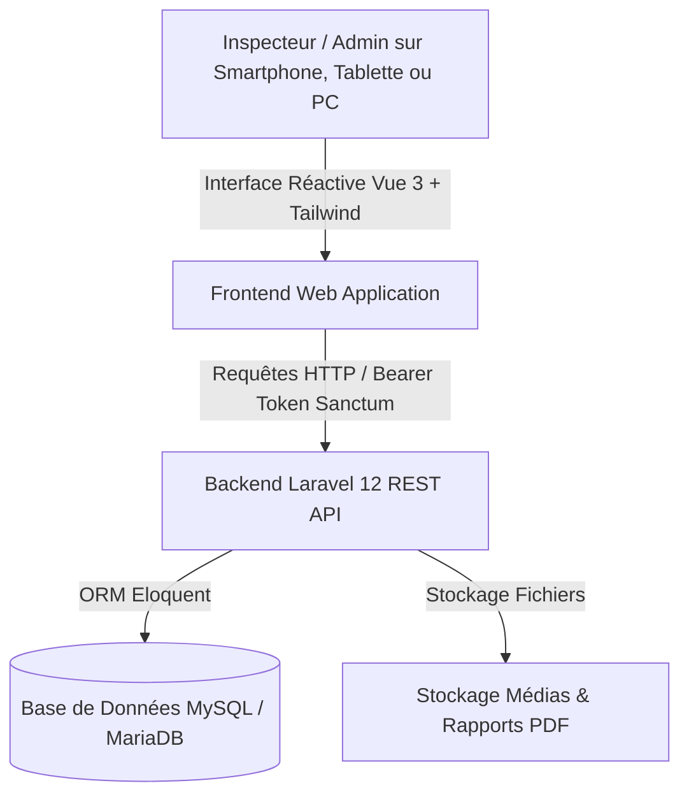
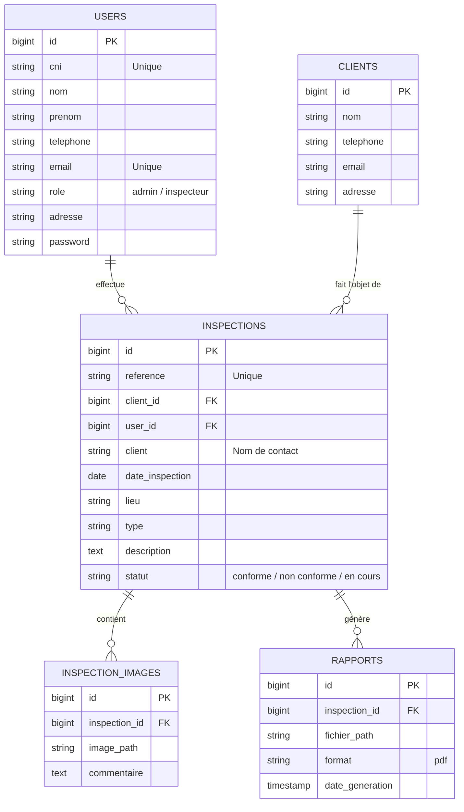

# 📋 Présentation Générale du Projet : Système de Gestion d'Inspections

Ce document détaille la finalité, l'architecture logicielle et l'ensemble des fonctionnalités concrètes de l'application **Inspections**.

---

## 1. 🎯 En quoi consiste le projet concrètement ?

Le projet est une **plateforme web moderne de gestion et de suivi d'inspections sur le terrain**. 

Elle est conçue pour des organismes, entreprises ou services de contrôle (contrôles sanitaires, agricoles, élevages ou techniques) ayant besoin :
1. **De déployer des inspecteurs sur le terrain** équipés de smartphones, tablettes ou PC portables.
2. **De consigner numériquement les constats** lors d'une visite : lieu, date, responsable/client rencontré, prise de photos classées par catégories, remarques et niveau de conformité.
3. **De générer et exporter automatiquement des rapports officiels (PDF)** pour le client ou la hiérarchie.
4. **De piloter l'activité globale via un tableau de bord analytique** (taux d'inspections, conformité, évolution mensuelle).
5. **D'administrer les comptes des agents** avec des rôles définis (*Administrateur*, *Inspecteur*).

---

## 2. 🏗️ Architecture et Technologies

L'application adopte une architecture découplée **Frontend / Backend** communiquant via une **API RESTful**.

### 🔹 Backend (Dossier `Projet-backend/`)
* **Framework** : **Laravel 12** (PHP 8.2+).
* **Architecture** : MVC / API RESTful.
* **Sécurité & Authentification** : **Laravel Sanctum** (authentification via Tokens Bearer).
* **Base de données & ORM** : **Eloquent** avec gestion des suppressions douces (*SoftDeletes*) pour garantir la traçabilité légale des audits.
* **Gestion des fichiers** : Téléversement et gestion sécurisée des photos de constats et documents PDF.

### 🔹 Frontend (Dossiers `Projet-frontend/` et `recup/`)
* **Framework** : **Vue.js 3** avec la syntaxe moderne **Composition API** (`<script setup>`).
* **Tooling & Build** : **Vite** pour des performances optimales et un rechargement à chaud instantané.
* **Design & Style** : **Tailwind CSS** avec une approche **Ultra-Responsive** (interfaces adaptées au pixel près pour mobiles, tablettes et écrans larges).
* **Gestion d'état** : **Pinia** avec persistance locale (`pinia-plugin-persistedstate`).
* **Routing** : **Vue Router** avec gardes d'authentification (`beforeEach`).
* **Sécurité de session** : Déconnexion automatique après inactivité prolongée (10 minutes).
* **UX / Notifications** : Système personnalisé de notifications toasts dynamiques avec barres de progression et pause au survol.

---

## 3. 💼 Parcours et Fonctionnalités Concrètes

### 1. 🔐 Authentification & Sécurité Terrain
* **Connexion par identifiants** (email et mot de passe).
* **Gestion de session** : Stockage sécurisé du token d'accès.
* **Sécurité automatique en cas d'oubli** : Un composable (`useInactivityLogout`) surveille les interactions de l'utilisateur (clavier, souris, défilement, tactile). Si l'inspecteur quitte son appareil sans verrouiller, la session se ferme après 10 minutes.
* **Protection des pages** : Redirection automatique vers `/login` si l'utilisateur n'est pas authentifié.

### 2. 📊 Tableau de bord (Dashboard)
Dès la connexion, l'utilisateur accède à une vue panoramique de l'activité :
* **Compteurs statistiques clés** :
  * Total d'inspections enregistrées.
  * Inspections réalisées durant le mois en cours.
  * Taux d'évolution et comparatif par rapport au mois précédent.
  * Nombre total de photos téléversées.
* **Raccourcis rapides** : Boutons proéminents pour lancer immédiatement une nouvelle inspection ou accéder à l'historique complet.
* **Flux des dernières inspections** : Liste des 5 dernières interventions avec badge de conformité coloré et lien direct vers le dossier complet.

### 3. ✍️ Création d'une inspection (Formulaire en 3 étapes guidées)
Le formulaire guide l'agent pas à pas sans risque d'erreur ou d'omission :
* **Étape 1 : Informations générales**
  * Date d'inspection (pré-remplie à aujourd'hui).
  * Type d'intervention (ex: *Inspection sanitaire*, *Contrôle qualité*, etc.).
  * Lieu de la visite.
  * Nom complet du responsable ou client inspecté.
* **Étape 2 : Galerie de photos par catégories**
  * L'agent peut créer des catégories personnalisées (ex: *Installations*, *Hygiène*, *Équipements*, *Façade*, etc.).
  * Pour chaque catégorie : téléversement multiple de photos (drag & drop ou sélecteur de fichier photo mobile).
  * Prévisualisation instantanée avec possibilité de supprimer une photo erronée.
* **Étape 3 : Synthèse et Conformité**
  * Observations générales détaillées.
  * Verdict de conformité : **Conforme** (vert), **Partiellement conforme** (jaune), **Non conforme** (rouge).
  * Recommandations et mesures correctives prescrites.
* **Envoi au serveur** : Transmission groupée des métadonnées et des fichiers images en format `multipart/form-data`.

### 4. 📂 Historique, Recherche et Filtres
* **Double mode d'affichage** :
  * *Vue Grille (Grid)* : Idéale pour parcourir visuellement les cartes d'inspections avec leurs miniatures.
  * *Vue Liste (Tableau compact)* : Optimisée pour un tri rapide et une consultation dense.
* **Outils de recherche & filtres combinés** :
  * Recherche textuelle (par mot-clé sur le lieu ou le nom du client).
  * Filtrage par type d'inspection.
  * Filtrage par statut de conformité.
  * Filtrage temporel (date de début et date de fin).
* **Bouton de réinitialisation** immédiate des critères.

### 5. 🔍 Détail d'une inspection & Rapports
* **Fiche récapitulative complète** : Données de l'inspection, coordonnées de l'inspecteur en charge, statut de conformité proéminent.
* **Galerie photo interactive avec Lightbox** :
  * Photos classées par catégorie.
  * Clic sur une image ouvrant une visionneuse plein écran sombre (*lightbox*) avec navigation suivante / précédente et compteur d'images.
* **Export PDF** : Bouton de téléchargement du rapport officiel généré par le backend.

### 6. 👥 Administration des Utilisateurs
* **Annuaire des comptes** : Liste paginée des collaborateurs avec recherche instantanée et filtre par rôle.
* **Rôles disponibles** :
  * `Administrateur` : Accès global à la configuration et gestion de l'équipe.
  * `Inspecteur` : Agent de terrain réalisant les visites et saisies.
* **Gestion complète (CRUD)** :
  * Création d'un nouvel agent avec nom, prénom, email, téléphone (format international `+225`), rôle et mot de passe.
  * Modification d'un compte existant.
  * Suppression d'un utilisateur.

### 7. 👤 Gestion du Profil Personnel
* Consultation et mise à jour de ses informations individuelles (Nom, Prénom, Téléphone, Numéro de pièce d'identité CNI).
* Modification sécurisée du mot de passe avec contrôle de cohérence.

---

## 4. 🗄️ Structure de la Base de Données

Le schéma relationnel est centré autour de l'acte d'inspection :

---

## 5. 📁 Organisation du Dépôt

Le dossier du projet comprend actuellement :
* **`Projet-backend/`** : L'API Laravel 12 (migrations, modèles Eloquent, routes API, contrôleurs d'authentification et de dashboard).
* **`Projet-frontend/`** : La base initiale du frontend Vue 3.
* **`recup/`** : **La version la plus récente et la plus aboutie du frontend**, contenant :
  * La modularisation des composants d'utilisateurs (`UserFilters`, `UserList`, `UserModal`, `UserPagination`, `UserEmptyState`).
  * La page de profil et modification du mot de passe (`Profil.vue`).
  * L'alignement des propriétés du modèle avec l'API backend (`lieu`, `client`, `statut`, etc.).
  * Les derniers commits de travail de l'historique Git.

---

## 6. 🚀 Synthèse et Recommandations

L'application est solidement pensée avec une ergonomie soignée, particulièrement adaptée au travail mobile sur le terrain :
1. **Ergonomie exemplaire** : Le parcours de saisie en 3 étapes avec ajout dynamique de photos et de catégories est intuitif et direct.
2. **Design moderne et réactif** : La responsivité a fait l'objet d'un soin particulier avec des classes Tailwind adaptées (mobile, tablette, desktop).
3. **Prochaines étapes conseillées** :
   * **Consolidation Frontend** : Déplacer/synchroniser le contenu validé de `recup/` dans `Projet-frontend/` pour unifier l'arborescence et supprimer le dossier temporaire `recup`.
   * **Complétion des contrôleurs Backend** : Brancher les méthodes de `InspectionController.php` (qui sont actuellement vides) sur les tables `inspections` et `inspection_images` pour enregistrer les données créées par l'interface Vue.
   * **Génération PDF** : Connecter une bibliothèque Laravel (telle que `barryvdh/laravel-dompdf`) pour produire le fichier PDF téléchargeable depuis `InspectionDetail.vue`.
